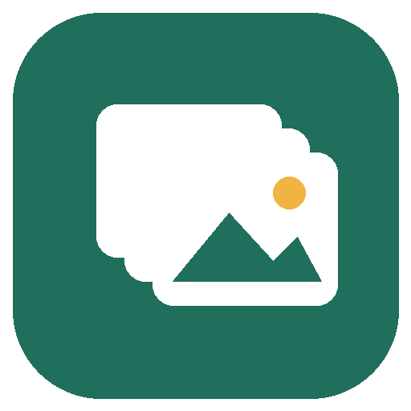

<h1 align="center">Gom Ảnh</h1>

<b>Điện thoại · Ổ đĩa · Google Photos → một kho duy nhất, tự xếp theo ngày, không trùng lặp.</b> 
Phần mềm miễn phí cho Windows 10/11.

## ⬇️ Tải về

**[Tải bộ cài mới nhất](../../releases/latest)**: chọn file `GomAnh-Setup-x.y.z.exe` ở mục *Assets*, bấm đúp để cài. Không cần quyền quản trị.

> Lần đầu cài, nếu Windows SmartScreen cảnh báo, bấm **More info → Run anyway**.

## Tính năng

- 📱 Chép ảnh từ **iPhone, Android** qua cáp USB, không cần iTunes
- 💽 Gom ảnh từ **ổ cứng, USB, thẻ nhớ**, thư mục cũ
- ☁️ Lấy ảnh **Google Photos** qua Google Takeout, giữ đúng ngày chụp
- 🗂️ Tự xếp vào `Năm\Năm-Tháng` theo ngày chụp thật
- 🧬 **Chống trùng theo nội dung**: ảnh khác tên vẫn nhận ra
- ✨ **Lọc ảnh xấu**: trong các ảnh chụp liên tiếp, đề xuất giữ tấm nét và đẹp nhất
- 🔒 Không xóa ảnh gốc, không gửi dữ liệu lên mạng

## Cách dùng nhanh

1. Mở Gom Ảnh, chọn **kho lưu trữ** (nên đặt ở ổ dung lượng lớn).
2. Thêm nguồn: **Điện thoại**, **Ổ đĩa / Thư mục**, hoặc **Google Photos**.
3. Bấm **▶ Bắt đầu gom ảnh**.

---

Phát triển bởi **ThS. Phạm Thị Hồng Thắm** · © 2026
